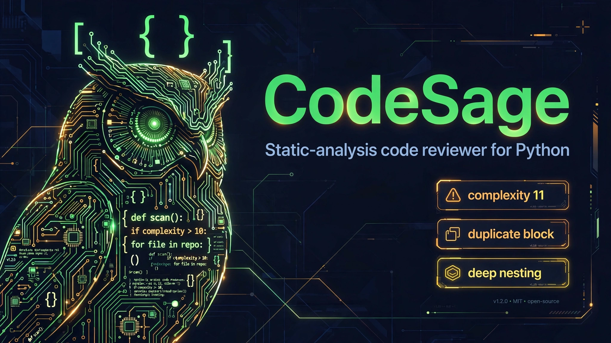
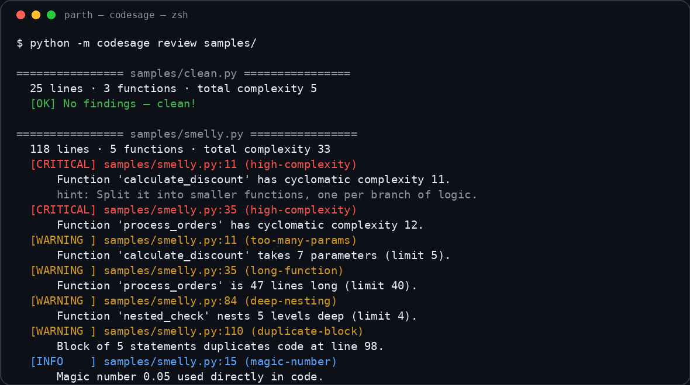
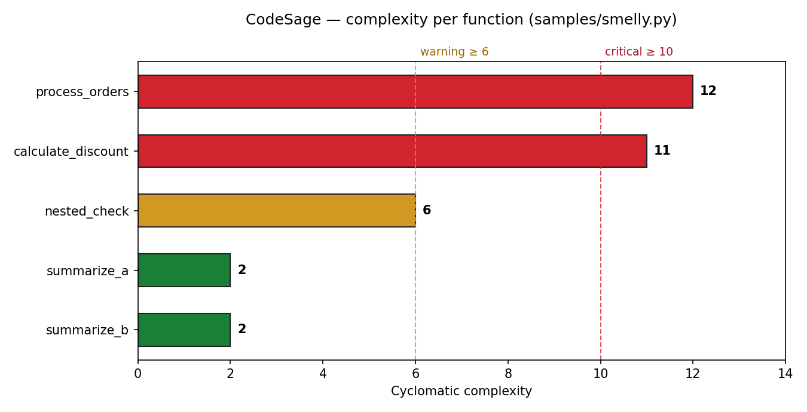

# 🔎 CodeSage — static-analysis code reviewer for Python

[](https://www.python.org/)
[](#testing)
[](LICENSE)
[](#tech-stack)

CodeSage reads your Python code the way a compiler does — by parsing it into an **AST** — and reviews it like a senior engineer would: it measures **cyclomatic complexity**, hunts down **code smells** (long functions, deep nesting, duplicated blocks, magic numbers, too many parameters, long files), and reports everything as **severity-ranked findings** with file:line, a rule id, an explanation, and a concrete fix suggestion.

100% offline. No API keys, no network, no telemetry. Your code never leaves your machine.

## Screenshots

**CLI review of the bundled samples** — clean file passes, smelly file gets flagged:



**Cyclomatic complexity per function** (real CodeSage output on `samples/smelly.py`, rendered with matplotlib):



## Features

- **Cyclomatic complexity from the AST** — per function and per file. Counts decision points: `if`/`elif`, `for`/`while`, `except` handlers, `assert`, ternaries, `and`/`or` operands, comprehensions, and `match`/`case`.
- **Smell detectors**:
  - `long-function` — functions over N lines
  - `deep-nesting` — nesting deeper than N levels
  - `duplicate-block` — **clone detection**: sliding windows of statements are normalized (names/literals abstracted) and hashed, so even renamed copies are caught
  - `magic-number` — unexplained numeric literals (named `UPPER_CASE` constants are exempt)
  - `too-many-params` — parameter-count limits
  - `long-file` — oversized modules
- **Severity-ranked findings** — `critical` / `warning` / `info`, each with `file:line`, rule id, explanation, and a fix suggestion.
- **Reports** — terminal output, Markdown, and a self-contained HTML report (inline CSS, no external assets).
- **CI-friendly CLI** — exits non-zero when critical findings exist.
- **Tunable thresholds** — every limit is a CLI flag (`--max-function-lines`, `--max-nesting`, `--warn-complexity`, …).

## Quickstart

```bash
# 1. Clone and enter
git clone https://github.com/872000/codesage.git
cd codesage

# 2. (Optional) create a virtualenv
python3 -m venv .venv && source .venv/bin/activate

# 3. Install the one dependency (charts only — the analyzer is stdlib)
pip install -r requirements.txt

# 4. Review the bundled samples
python3 -m codesage review samples/

# 5. Review your own code, write a Markdown report
python3 -m codesage review /path/to/your/code --format md --output report.md

# 6. Or a self-contained HTML report
python3 -m codesage review /path/to/your/code --format html --output report.html

# 7. Run the test suite
python3 -m pytest
```

> **Exit codes:** `0` = no critical findings, `1` = critical findings (useful in CI), `2` = target not found.

### Example

```
$ python3 -m codesage review samples/

================ samples/clean.py ================
  25 lines · 3 functions · total complexity 5
  ✅ No findings — clean!

================ samples/smelly.py ================
  118 lines · 5 functions · total complexity 33
  🔴 [CRITICAL] samples/smelly.py:11 (high-complexity) — Function 'calculate_discount' has cyclomatic complexity 11 (threshold 10).
             💡 Split it into smaller functions, one per branch of logic.
  🟡 [WARNING ] samples/smelly.py:35 (long-function) — Function 'process_orders' is 47 lines long (limit 40).
             💡 Break it into smaller, single-purpose functions.
  ...
📊 2 file(s): 🔴 2 critical · 🟡 5 warnings · 🔵 17 info
```

### Tune the rules

```bash
python3 -m codesage review src/ \
  --max-function-lines 30 \
  --max-nesting 3 \
  --max-params 4 \
  --warn-complexity 5 \
  --critical-complexity 8
```

## Tech stack

| Layer | Technology |
|---|---|
| Parsing | Python `ast` module (stdlib) — full syntax-tree analysis |
| Complexity | Custom `ComplexityVisitor`: McCabe cyclomatic complexity per function |
| Clone detection | Statement normalization + SHA-256 hashing over sliding windows |
| Reports | Markdown + self-contained HTML (inline CSS) |
| Charts | matplotlib (the only dependency) |
| CLI | `argparse`, `python -m codesage review <target>` |
| Tests | pytest, 18 tests covering complexity math, every detector, and both reports |

No frameworks, no API keys, no network calls — analysis is pure local computation.

## Project structure

```
codesage/
├── assets/                  # hero banner, complexity chart, CLI screenshot
├── codesage/                # the analyzer package
│   ├── __init__.py          # public API + version
│   ├── __main__.py          # python -m codesage entry point
│   ├── analyzer.py          # orchestrates: parse → metrics → smells → report
│   ├── cli.py               # argparse CLI (review command, exit codes)
│   ├── complexity.py        # cyclomatic complexity + nesting from the AST
│   ├── models.py            # Finding / FunctionMetrics / FileReport dataclasses
│   ├── reporter.py          # Markdown + self-contained HTML renderers
│   └── smells.py            # detectors + tunable Config thresholds
├── samples/
│   ├── clean.py             # clean sample → zero findings
│   └── smelly.py            # deliberately smelly sample → every rule fires
├── scripts/
│   ├── gen_chart.py         # regenerates assets/complexity_chart.png
│   └── gen_terminal.py      # regenerates assets/cli_demo.png
├── tests/
│   └── test_codesage.py     # 18 pytest tests
├── LICENSE                  # MIT
├── README.md
├── requirements.txt         # matplotlib (charts only)
└── requirements-dev.txt     # pytest
```

## API

```python
from codesage import analyze_file, analyze_path
from codesage.reporter import render_markdown, render_html

report = analyze_file("samples/smelly.py")
print(report.total_complexity)          # 33
print(report.counts())                  # {'critical': 2, 'warning': 5, 'info': 17}

reports = analyze_path("src/")          # recursive *.py scan
open("report.md", "w").write(render_markdown(reports))
open("report.html", "w").write(render_html(reports))
```

## Testing

```bash
python3 -m pytest -v
```

18 tests cover: exact complexity of known functions (3 and 6), long-function firing/silence, duplicate detection (planted copy, renamed-variable copy, unique code), deep nesting, parameter limits, magic numbers (named constants exempt), critical thresholds, syntax-error handling, clean sample → zero criticals, smelly sample → every major rule fires, Markdown/HTML report contents, and severity sorting.

## Roadmap

- [ ] Halstead metrics and maintainability index
- [ ] Unused import/variable detection via scope analysis
- [ ] SARIF output for GitHub code scanning integration
- [ ] `--fail-on warning` mode and baseline/diff mode for PRs
- [ ] Pre-commit hook packaging
- [ ] Type-annotation coverage rule

## License

MIT — see [LICENSE](LICENSE). Copyright (c) 2026 Parth (872000).
